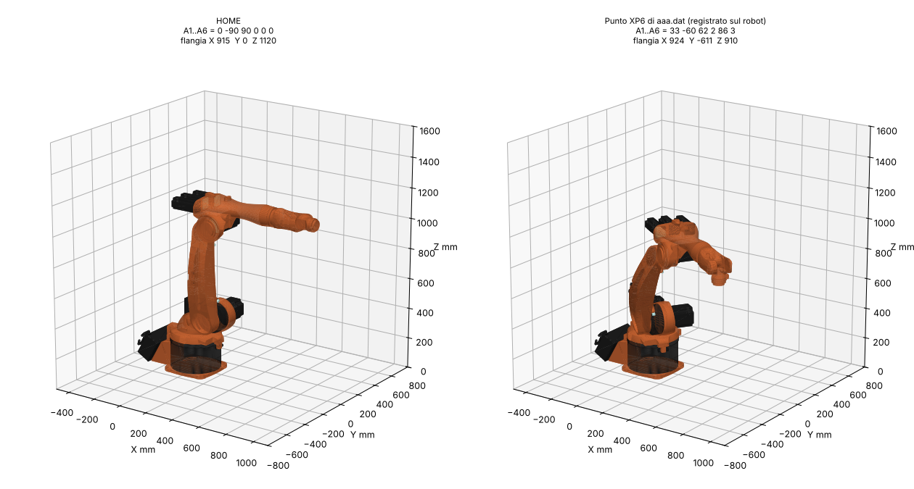

# Gemello digitale KUKA KR 5 arc

Cartella da copiare dentro `Assets/` del progetto Unity: contiene il robot con
la geometria vera, pronto da muovere con gli angoli del pendant.



| File | Contenuto |
|---|---|
| `Scripts/KR5ArcModel.cs` | componente: costruisce il robot, lo muove con A1..A6 in gradi pendant, cinematica diretta in X/Y/Z/A/B/C KUKA |
| `Resources/KR5arc_mesh.bytes` | mesh del robot (7 parti, ~30 000 triangoli, colori originali) |

## Uso

1. Crea un GameObject vuoto dove sta la base del robot reale (sul pavimento):
   asse Z locale = avanti del robot, Y locale = alto.
2. Aggiungi il componente **KR5ArcModel**. Il robot compare subito anche in
   edit mode, in posa HOME.
3. Muovilo dall'Inspector (`axesDeg`) o da codice:
   ```csharp
   model.SetAxesDeg(new float[] { 30, -60, 60, 0, 85, 0 });
   bool ok = KR5ArcModel.WithinLimits(assi);          // fine corsa di $machine.dat
   KR5ArcModel.FlangeKuka(assi, xyzabc);              // X,Y,Z mm e A,B,C gradi
   Transform tcp = model.Flange;                      // forward = asse utensile
   ```

## Da dove vengono i dati

- **Geometria**: modello `KUKA-KR-5-arc.robot` della libreria RoboDK, convertito
  con `tools/robodk_kr5arc_export.py` (lo scarica da solo se non gli passi il
  file). Per rigenerare: `python tools/robodk_kr5arc_export.py`.
- **Cinematica**: tabella DH modificata del modello RoboDK, identica nelle
  lunghezze a quella del manuale (400, 180, 600, 120, 620, 115 mm).
- **Versi degli assi** (-1, 1, 1, -1, 1, -1) e **fine corsa**: verificati con i
  dati del robot reale. `tools/verify_kr5arc.py` ricostruisce gli 11 punti del
  programma `aaa.dat` registrati sul controller e ritrova per ognuno una
  soluzione con lo stesso bit Turn salvato dal KRC2 (11/11).
- **Dati macchina**: `robot/mada/$machine.dat` (trasformazione `#KR5 C2 FLR ZH02`).

## Attenzione: convenzione degli angoli in KR5ArcKinematics.cs

Il progetto "kuka vr" usa `KR5ArcKinematics.cs` con angoli DH (zero = braccio
verticale), ma applica a quegli angoli i fine corsa del pendant. Le due
convenzioni sono legate da (verificato confrontando le due cinematiche su
posizione e orientamento):

| Asse | DH -> pendant |
|---|---|
| A1 | A1 = -q1 |
| A2 | A2 = -q2 - 90 |
| A3 | A3 = 90 - q3 |
| A4 | A4 = -q4 |
| A5 | A5 = q5 - 90 |
| A6 | A6 = -q6 |

Quindi il controllo dei limiti di `TrajectoryValidator` scarta pose valide e ne
accetta di non valide. Con `KR5ArcModel` i limiti si controllano direttamente
in gradi pendant.
